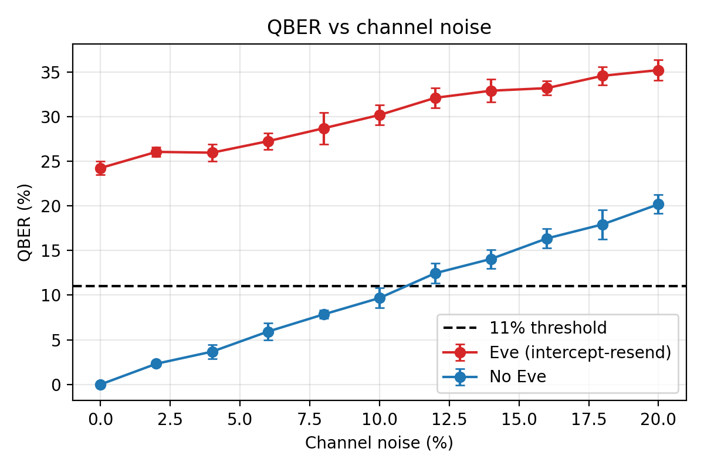
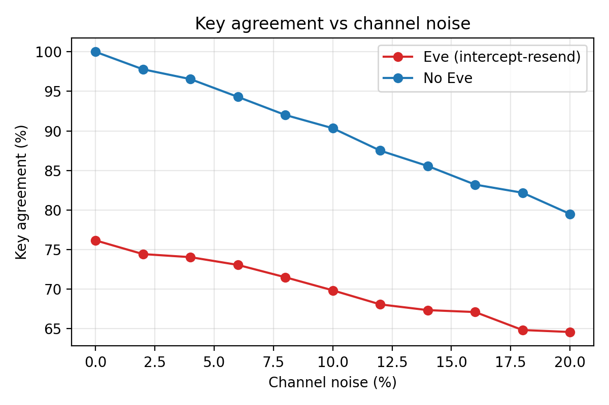
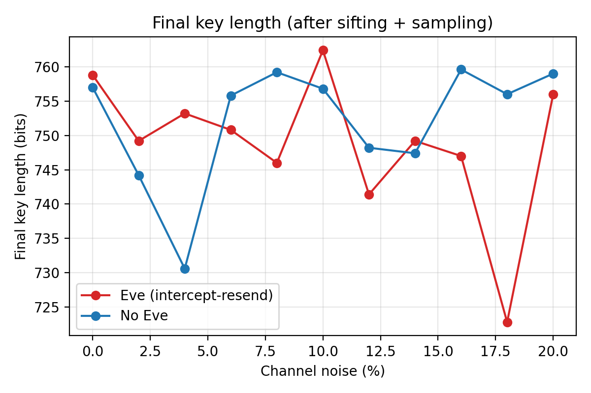
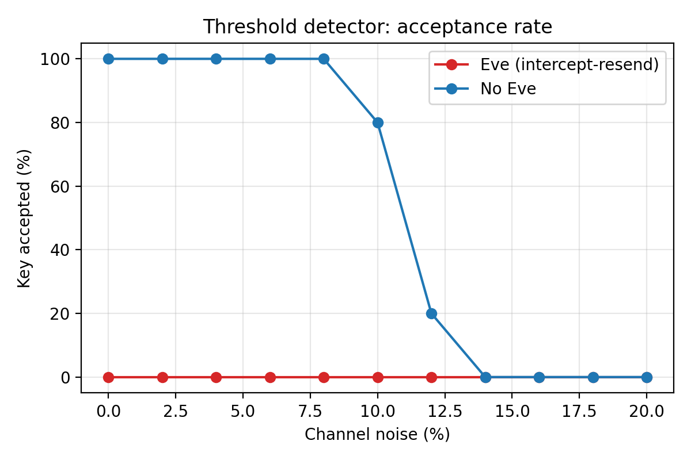
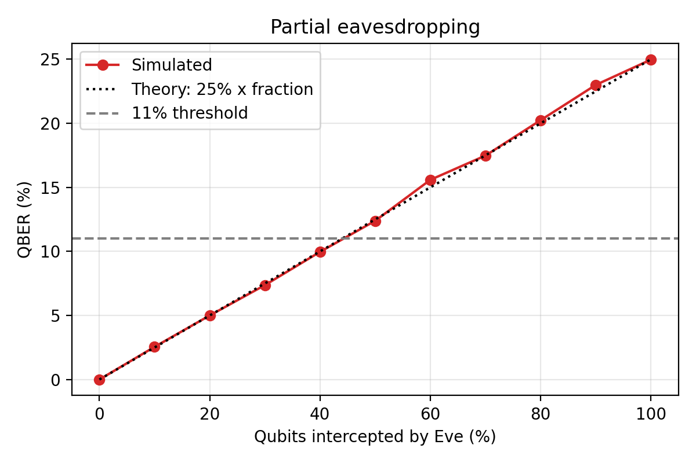

# Performance Analysis of BB84 Quantum Key Distribution under Noise and Eavesdropping using Qiskit

**IEG 313: Quantum Computing for Engineers: Theory and Applications**, IIIT Kottayam
**Team:** Bell State Bandits

A Qiskit simulation of the **BB84 quantum key distribution protocol**. It measures how channel noise (0 to 20%) and an intercept-resend eavesdropper (Eve) change the **Quantum Bit Error Rate (QBER)**, the key agreement and the final key length, and includes a **QBER-threshold detector** that accepts or rejects the key.

## Team
| Name | Roll No. |
|---|---|
| C. Nitesh Kumar (Leader) | 2024BCS0270 |
| J. Nandan | 2024BCS0190 |
| R. Mourya Reddy | 2024BCS0307 |
| Himanshu | 2024BCS0286 |
| S. Sameer Basha | 2024BCS0290 |

## How BB84 works
1. **Alice** picks random bits and random bases (Z or X) and sends the qubits.
2. **Bob** measures each qubit in a randomly chosen basis.
3. **Sifting:** over a public channel they compare *bases only* and keep positions where the bases matched (about 50%).
4. **QBER estimation:** they reveal a random sample (25%) of the sifted bits. The mismatch rate is the QBER. Revealed bits are discarded.
5. **Detector:** QBER <= 11% means **accept** (the rest is the secret key). QBER > 11% means **reject**.

Measuring a qubit in the wrong basis gives a random result and disturbs it, so an eavesdropper leaves errors behind: an **intercept-resend** attack gives about **25% QBER**.

| Basis | bit 0 | bit 1 |
|---|---|---|
| Z (0) | &#124;0&#10217; | &#124;1&#10217; |
| X (1) | &#124;+&#10217; | &#124;-&#10217; |

## What is simulated
| Component | Implementation |
|---|---|
| Qubit preparation / measurement | 1-qubit Qiskit circuits (X gate for the bit, H gate for the X basis) |
| Channel noise | Depolarizing error on the channel (`id` gate) in Qiskit Aer, scaled so noise % = flip probability |
| Eve | Intercept-resend: measures in a random basis, resends what she read. Optionally intercepts only a fraction of qubits |
| Sifting, QBER, detector | NumPy (`run_bb84` in `bb84_qkd.py`, one commented block per step) |
| Experiments and plots | pandas and Matplotlib |

Defaults: 2000 qubits per run, 25% sample, 11% threshold, 5 trials per setting.

## Repository structure
```
bb84-qkd-qiskit/
├── bb84_qkd.py        # all the code, heavily commented
├── BB84_QKD.ipynb     # notebook: runs demos, experiments, graphs
├── requirements.txt
├── results/           # CSVs + graphs produced by the experiments
└── README.md
```

## Setup and run
```bash
pip install -r requirements.txt

python bb84_qkd.py --demo          # one verbose run, with and without Eve
python bb84_qkd.py                 # full experiments -> results/
python bb84_qkd.py --trials 20 --seed 42   # smoother curves, reproducible
```
Or open `BB84_QKD.ipynb` in Jupyter and use **Run All**.

## Results (2000 qubits, 5 trials per point, seed 42)

| Setting | QBER | Detector |
|---|---|---|
| No noise, no Eve | 0% | Always accepted |
| Noise only | about equal to the noise level (2% noise gives 2.3%, 10% gives 9.7%) | Accepted up to 8%, mixed at 10-12%, rejected from 14% |
| Eve only (0% noise) | about 24% | Always rejected |
| Eve + noise (20%) | about 35% | Always rejected |



| | |
|---|---|
|  |  |
|  |  |

**Extension: partial eavesdropping.** If Eve intercepts a fraction *f* of the qubits, QBER is about 25% x *f*. In our runs the key was accepted up to about 40% interception and rejected from 60%, so a careful Eve can stay under the threshold. Real systems counter this with privacy amplification (not implemented here).

## Key takeaways
- Eve's intercept-resend attack raises the QBER to about 25%, matching the theory (she guesses the wrong basis 50% of the time, and then Bob errs 50% of the time).
- Noise raises the QBER roughly one-to-one.
- BB84 **cannot tell noise from eavesdropping**; both raise the QBER and the key is aborted.
- Final key length is about 37% of the qubits sent (50% survive sifting, then 25% of those are spent on the QBER sample).

## Limitations and future work
- No error correction (e.g. Cascade) or privacy amplification after sifting.
- Only intercept-resend attacks; no photon-number-splitting or other attacks.
- Noise is a simple depolarizing model, not a full hardware model.

## References
1. C. H. Bennett and G. Brassard, "Quantum cryptography: Public key distribution and coin tossing," *Proc. IEEE Int. Conf. Computers, Systems and Signal Processing*, Bangalore, India, 1984, pp. 175-179.
2. M.-Z. Mina and E. Simion, "A Scalable Simulation of the BB84 Protocol Involving Eavesdropping," *Cryptology ePrint Archive*, Paper 2020/1074, 2020.
